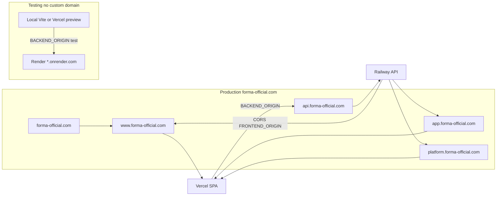
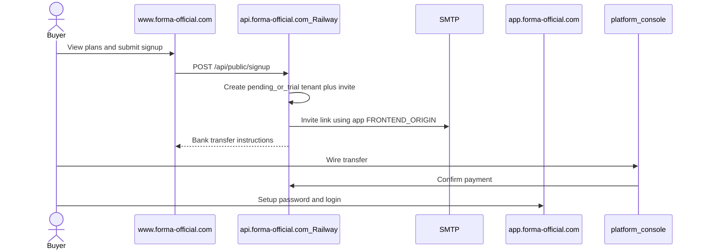

# Forma Domain Networking (`forma-official.com`)

Production networking for the Forma multi-tenant gym platform: custom domains only on **Railway (API)** and **Vercel (SPA)**. **Render** is the testing API and keeps its default `*.onrender.com` URL—do not attach `forma-official.com` to Render.

## 1. Two environments

| Env | API | Frontend | Custom domain |
|-----|-----|----------|---------------|
| **Production** | Railway | Vercel | Yes — hosts below on `forma-official.com` |
| **Testing** | Render (`render.yaml` / `leap-backend`) | Local Vite and/or Vercel preview | **No** — use `https://<service>.onrender.com` |

Keep production secrets, MongoDB, and bank payment config on Railway. Treat Render as disposable/staging with its own env. Never set production `FRONTEND_ORIGIN` hosts on the Render service if that would send live invite or password-reset emails to the wrong stack.

## 2. Production host map

| Host | Serves | Deploy target |
|------|--------|----------------|
| `api.forma-official.com` | Express API (`/api/*`, `/api/platform/*`, `/api/tenant/*`, `/uploads/*`, health) | Railway custom domain |
| `app.forma-official.com` | Gym staff SPA (`/login`, role routes) + `/auth/*` | Vercel |
| `platform.forma-official.com` | Platform console (optional; else use `app…/platform`) | Same Vercel project |
| `www.forma-official.com` (apex → www) | Public marketing + plans + purchase / signup | Same Vercel project |

### Topology: shared app host (not per-tenant DNS)

Tenants share one app host. The tenant **slug** (gym code) is a login/product identifier, not a DNS name.

Example — first tenant slug `leap`:

| What | URL / value |
|------|-------------|
| Staff login | `https://app.forma-official.com/login` (gym code **`leap`** when disambiguation is needed) |
| After login | Same host, e.g. `https://app.forma-official.com/owner/dashboard` |
| API | `https://api.forma-official.com/api/...` (tenant from JWT) |
| Not used at launch | `https://leap.forma-official.com` — do not create this CNAME |

Runtime isolation uses JWT `tenantId` / `tenantSlug` and `runWithTenant` (see `Backend/src/middleware/authMiddleware.js`). `X-Tenant-Slug` is a login hint only. `BASE_DOMAIN` documents the production root for a future vanity-subdomain phase; it is not required for request scoping today.

Auth is Bearer + `localStorage` with CORS `credentials: false`, so sessions do not cross subdomains without extra work.

## 3. DNS checklist (production only)

| Record | Target |
|--------|--------|
| Apex + `www` | Vercel |
| `CNAME app` | Vercel project |
| `CNAME platform` | Same Vercel project (or omit and use `https://app.forma-official.com/platform/login`) |
| `CNAME api` | Railway custom-domain target for the API service |

- Do **not** create `forma-official.com` DNS for the Render testing API.
- Enable TLS in Vercel and Railway after DNS verifies.

## 4. Environment variable matrix

### Railway (production API)

| Variable | Production value / notes |
|----------|--------------------------|
| `PORT` | Provided by Railway; bind `0.0.0.0` |
| `BASE_DOMAIN` | `forma-official.com` |
| `FRONTEND_ORIGIN` | `https://app.forma-official.com,https://www.forma-official.com,https://platform.forma-official.com` — **list `app` first** so invite/reset links from `passwordSetupService` hit the gym app |
| `MAIL_FROM` | `Forma <noreply@forma-official.com>` |
| `PAYMENT_*` | Full bank fields required; production checkout fails closed if bank name, account name, or IBAN is empty |
| `PAYMENT_GATEWAY_URL` | Optional later: `https://www.forma-official.com/checkout` |
| `MONGO_URI`, JWT secrets, R2 keys | **Separate** from the Render test service |

### Render (testing API only)

| Variable | Testing notes |
|----------|---------------|
| Service URL | Default `*.onrender.com` — no custom domain |
| `FRONTEND_ORIGIN` | Local Vite origin(s) and/or preview URL(s) only |
| Secrets / DB / bank | Test placeholders only |
| Blueprint | `render.yaml` remains the test blueprint |

### Vercel (production frontend build)

| Variable | Production value / notes |
|----------|--------------------------|
| `BACKEND_ORIGIN` | `https://api.forma-official.com` — never the Render URL for production builds |

### Local development

| Variable | Typical value |
|----------|----------------|
| Frontend `BACKEND_ORIGIN` | `http://localhost:5000` |
| API `FRONTEND_ORIGIN` | `http://localhost:5173` (comma-separate extra ports if needed) |

## 5. CORS and invite-link rules

- CORS allowlist is driven by `FRONTEND_ORIGIN` in `Backend/src/app.js` (comma-separated, trailing slashes stripped).
- Production Railway: the three `forma-official.com` browser origins above.
- Testing Render: localhost / preview only.
- Login host heuristic already treats `railway.app` and `onrender.com` as non-tenant hosts (no subdomain gym hint on PaaS URLs).
- Invite and password-reset absolute URLs use the **first** origin in `FRONTEND_ORIGIN` — keep `https://app.forma-official.com` first in production.

## 6. Security boundaries

| Surface | Auth | API prefix |
|---------|------|------------|
| Gym staff (tenant) | Tenant JWT (`JWT_SECRET`) | `/api/*` (scoped), `/api/tenant/*` |
| Platform console | Platform JWT (`PLATFORM_JWT_SECRET`, audience `leap-platform`) | `/api/platform/*` |
| Public marketing / plans (next) | None (rate-limited) | Planned `/api/public/*` only — **never** anonymous `/api/platform/*` |

Do not present a tenant bearer token to `/api/platform/*` or a platform token to tenant gym routes.

Default platform ops URL: `https://app.forma-official.com/platform/login`.

## 7. Public plans + purchase (contract for next build)

Public site on `www.forma-official.com`:

- `GET /` — marketing
- `GET /plans` — catalog
- `GET /get-started` or `/checkout` — signup + bank-transfer instructions

Planned unauthenticated API on **Railway**:

- `GET /api/public/plans` — active plans and prices via `runAsPlatform`
- `POST /api/public/signup` — rate-limited; create trial/pending tenant + owner invite; return bank-transfer instructions

Purchase completion stays **manual confirm** in the platform billing console (sales-assisted wire transfer). Fix known onboard/AuditLog issues before exposing public signup.

This document freezes the contract; it does not implement the public UI or `/api/public/*` routes.

## 8. Cutover checklist

1. Attach `api.forma-official.com` on the **Railway** API service; wait for TLS.
2. Attach `app`, `www` (and optional `platform` / apex) on the **Vercel** project; wait for TLS.
3. Set Railway env: `FRONTEND_ORIGIN` (app first), `BASE_DOMAIN`, `MAIL_FROM`, production `PAYMENT_*`, production secrets.
4. Set Vercel `BACKEND_ORIGIN=https://api.forma-official.com` and **redeploy** (build-time inject).
5. Confirm CSP allows `https://api.forma-official.com` (see §9). Keep `*.onrender.com` only if preview/test frontends still talk to Render.
6. Smoke-test: CORS from `app` and `www`, gym login, `/platform/login`, invite email link host = `app.forma-official.com`.
7. Do **not** migrate the custom domain onto Render.

## 9. Vercel CSP + origin cutover

Root [`vercel.json`](../vercel.json) and [`Frontend/vercel.json`](../Frontend/vercel.json) Content-Security-Policy `connect-src` / `img-src` must allow the API the browser calls:

| Target | When |
|--------|------|
| `https://api.forma-official.com` | **Required** for production |
| `https://*.railway.app` | Optional short-lived smoke tests before the custom API domain is live |
| `https://*.onrender.com` | Testing / legacy preview only — not production `BACKEND_ORIGIN` |
| `http://localhost:5000` | Local development |

Production frontend builds must use `BACKEND_ORIGIN=https://api.forma-official.com`. Pointing a production Vercel deployment at the Render URL mixes prod UI with the test API and must be avoided.

## 10. Non-goals (launch)

- Per-tenant subdomains (`leap.forma-official.com`)
- Cookie-based SSO across `app` / `www` / `platform`
- Custom DNS or vanity domains on the Render testing API
