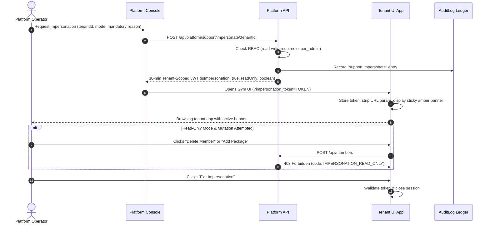

# Leap Platform Console Specification & Operations Manual

This document details the architecture, security isolation model, permission matrices, metric formulas, and operational runbooks for the **Leap Gym SaaS Platform Console** (Super Admin system).

---

## 1. Security Architecture & Domain Separation

The Platform Console operates in a **strictly isolated security domain**, completely separate from gym tenant organizations.

```mermaid
graph TD
    Client[Browser Client]
    
    subgraph "Platform Console Domain (/platform/*)"
        PlatformRoute["/platform/* (Vite route namespace)"]
        PlatformAPI["/api/platform/* (Platform API router)"]
        PlatformAuth["Platform JWT (aud: 'leap-platform', iss: 'leap-platform')"]
        PlatformUserDB[("PlatformUsers Collection")]
        PlatformRoute --> PlatformAPI
        PlatformAPI --> PlatformAuth
        PlatformAuth --> PlatformUserDB
    end

    subgraph "Tenant Gym Domain (/*)"
        TenantRoute["/* (Gym App layout + TenantProvider)"]
        TenantAPI["/api/* (Scoped Gym API)"]
        TenantAuth["Tenant JWT (gym-scoped)"]
        TenantUserDB[("Users Collection (tenantId scoped)")]
        TenantRoute --> TenantAPI
        TenantAPI --> TenantAuth
        TenantAuth --> TenantUserDB
    end

    PlatformAPI -.->|runAsPlatform() cross-tenant query| TenantUserDB
```

### 1.1 Strict Isolation Invariants
1. **Zero Tenant Context on Platform Routes**:
   - The platform console frontend lives under the `/platform/*` route namespace.
   - `TenantProvider` and gym-specific context hooks are **never** mounted under `/platform/*`.
   - The platform frontend never requests gym tenant branding, gym themes, or gym-specific settings.
2. **Dedicated Identity Collection**:
   - Platform operators are stored in `PlatformUsers` (`Backend/src/models/PlatformUser.js`).
   - Platform users do not exist in the tenant `Users` collection and have no `tenantId`.
3. **Cryptographic Token & Audience Separation**:
   - Platform tokens are signed using `PLATFORM_JWT_SECRET` (distinct from `JWT_SECRET`).
   - Platform tokens carry `aud: "leap-platform"` and `iss: "leap-platform"`.
   - If a tenant bearer token is presented to `/api/platform/*`, it is rejected with `401 Unauthorized`.
   - If a platform bearer token is presented to tenant endpoints `/api/*`, it is rejected with `401 Unauthorized`.
4. **Cross-Tenant Access Boundary**:
   - Cross-tenant inspection by platform operators executes **only** through `runAsPlatform(fn, { actorId, reason })`.
   - Direct database queries without `runAsPlatform` in the platform layer are rejected by the Mongoose `tenantPlugin`.
5. **Secret Masking Guarantee**:
   - Plaintext passwords, bcrypt hashes, WhatsApp access tokens, payment provider private keys, and `TENANT_SECRET_KEY` are stripped from all API responses.

---

## 2. Platform RBAC & Permission Matrix

The platform console implements fine-grained Role-Based Access Control (RBAC) across four operational roles:

| Category | Permission Key | Description | `super_admin` | `billing` | `support` | `analyst` |
|---|---|---|:---:|:---:|:---:|:---:|
| **Platform Users** | `platform_users.read` | View platform team accounts | ✅ | ❌ | ❌ | ❌ |
| | `platform_users.manage` | Invite, edit roles, toggle status | ✅ | ❌ | ❌ | ❌ |
| | `platform_users.reset_mfa` | Reset operator MFA / revoke sessions | ✅ | ❌ | ❌ | ❌ |
| **Tenants** | `tenants.read` | Search and view tenant profiles | ✅ | ✅ | ✅ | ✅ |
| | `tenants.create` | Onboard new gym tenants | ✅ | ❌ | ❌ | ❌ |
| | `tenants.lifecycle` | Suspend, activate, cancel, extend trial | ✅ | ❌ | ❌ | ❌ |
| | `tenants.overrides` | Edit feature and seat limit overrides | ✅ | ❌ | ❌ | ❌ |
| | `tenants.notes` | Add/delete internal tenant notes | ✅ | ✅ | ✅ | ❌ |
| | `tenants.purge` | Hard-delete soft-deleted tenants | ✅ | ❌ | ❌ | ❌ |
| **Plans & Pricing** | `plans.read` | View plans and feature catalog | ✅ | ✅ | ✅ | ✅ |
| | `plans.manage` | Create, edit, and archive plans | ✅ | ❌ | ❌ | ❌ |
| | `pricing.manage` | Manage PlanPrice and open/close sales | ✅ | ✅ | ❌ | ❌ |
| | `coupons.manage` | Create and retire promotional coupons | ✅ | ✅ | ❌ | ❌ |
| **Billing Operations** | `billing.payments` | Review and confirm/reject payments | ✅ | ✅ | ❌ | ❌ |
| | `billing.invoices` | Generate and download invoices | ✅ | ✅ | ❌ | ❌ |
| | `billing.refunds` | Process refunds and revoke licenses | ✅ | ✅ | ❌ | ❌ |
| | `billing.grants` | Issue manual complimentary grants | ✅ | ✅ | ❌ | ❌ |
| | `billing.ledger` | View and export financial audit ledger | ✅ | ✅ | ❌ | ✅ |
| **Analytics** | `analytics.revenue` | View MRR, ARR, and cash revenue | ✅ | ✅ | ❌ | ✅ |
| | `analytics.usage` | View storage, WhatsApp, and cost metrics | ✅ | ✅ | ✅ | ✅ |
| **Support** | `support.impersonate` | Launch audited "View As" session | ✅ | ❌ | ✅ | ❌ |
| | `support.export` | Export tenant data archive (JSON) | ✅ | ❌ | ✅ | ❌ |
| **System** | `system.announcements`| Broadcast platform-wide alerts | ✅ | ❌ | ❌ | ❌ |
| | `system.maintenance` | Toggle global maintenance mode | ✅ | ❌ | ❌ | ❌ |

---

## 3. Impersonation & Support Protocol

Platform operators can troubleshoot tenant issues by launching an audited "View As" session.



### Guardrails:
1. **Default Mode**: Always `read_only`.
2. **Mutation Blocking**: `Backend/src/middleware/authMiddleware.js` automatically rejects `POST`, `PUT`, `PATCH`, and `DELETE` requests with `403 Forbidden` (`IMPERSONATION_READ_ONLY`) when `req.user.isImpersonation && req.user.readOnly`.
3. **Audited Actions**: Every request performed while impersonating stamps `impersonatedBy: { id, email, name }` into the `AuditLog`.
4. **Visual Indicator**: Persistent, high-visibility amber sticky header displayed across the gym app showing admin name, mode, and one-click exit.

---

## 4. Tenant Lifecycle & Data Retention Policy

### 4.1 State Machine
```
[Trial] ──(expiring)──> [Past Due] ──(grace period ends)──> [Suspended] ──> [Cancelled]
   │                                                                             │
   └──────────────(Paid Purchase / Manual Grant)────────────────> [Active]       │
                                                                                 ▼
                                                                        [Soft Deleted]
                                                                        (90-day window)
                                                                                 │
                                                                                 ▼ (super_admin purge)
                                                                         [HARD PURGED]
                                                                 (Surviving Tombstone Audit)
```

### 4.2 Data Retention & Hard Purge Protocol
1. **Cancellation / Retention**:
   - When a tenant is cancelled, `isSoftDeleted` is set to `true`, and `purgeScheduledAt` is set to `now + PLATFORM_TENANT_RETENTION_DAYS` (default: 90 days).
   - All tenant data remains encrypted and isolated in the database for 90 days in case the customer reactivates or requests a GDPR/compliance archive export.
2. **Hard Purge Execution**:
   - Only `super_admin` role can trigger hard purges (`DELETE /api/platform/tenants/:id/purge`).
   - Requires typing the exact tenant slug (`confirmSlug: "gym-slug"`) to prevent accidental destruction.
   - Deletes all records across 16 collections: `Users`, `Members`, `Subscriptions`, `Packages`, `AttendanceLogs`, `SalesLeads`, `TenantNotes`, `TenantUsages`, etc.
   - Deletes all tenant media assets on disk/S3 (`uploads/tenants/:tenantId/*`).
   - Generates an immutable, non-scoped tombstone record in `AuditLog` preserving the purge timestamp, actor, and summary statistics.

---

## 5. Billing Engine & Financial Metrics

### 5.1 MRR & Lifetime Deal Invariants
- **Monthly Recurring Revenue (MRR)**:
  $$\text{MRR} = \sum_{\text{active monthly}} \text{Monthly Fee} + \sum_{\text{active yearly}} \left(\frac{\text{Yearly Fee}}{12}\right)$$
- **Strict Invariant**: Lifetime deal revenue is one-time capital collected; it is **strictly excluded** from MRR and ARR.
- **Annual Recurring Revenue (ARR)**:
  $$\text{ARR} = \text{MRR} \times 12$$
- **Net Revenue Retention (NRR)**:
  $$\text{NRR} = \frac{\text{Starting MRR} + \text{Expansion} - \text{Contraction} - \text{Churn}}{\text{Starting MRR}} \times 100\%$$
- **Pre-computed Daily Snapshots**:
  Dashboards read from the `PlatformMetricSnapshot` collection computed via scheduled daily jobs, ensuring $O(1)$ zero-delay dashboard response times without heavy cross-collection aggregations.

### 5.2 Sequential Invoicing
- Sequential per-platform invoice numbering generated atomically via `PlatformCounters`:
  `INV-{YEAR}-{0001}` (e.g. `INV-2026-0001`, `INV-2026-0002`).
- HTML/PDF template rendering with platform tax details, gym name, currency, line items, and payment reference numbers.

---

## 6. Operational Runbooks

### Runbook 1: Bootstrapping First Super Admin
To create the root platform super administrator on a fresh environment:
```bash
# In Backend directory:
npm run create-first-super-admin
```
Follow the interactive prompts:
1. Enter Administrator Name.
2. Enter Administrator Email (unique).
3. Enter Password (minimum 8 characters; never hardcoded in scripts).
4. Save the generated Base32 MFA secret or scan the QR URI into Google Authenticator / 1Password.
5. Save the 8 emergency backup recovery codes in a secure vault.

### Runbook 2: Onboarding a New Gym Tenant
1. Navigate to `/platform/tenants` and click **+ Onboard Tenant**.
2. Enter Gym Name, Slug (validates uniqueness and reserved keywords), Owner Name, and Owner Email.
3. Select Plan (Starter, Professional, Enterprise) and Billing Cycle (Monthly, Yearly, Lifetime).
4. Choose Initial State: Active or Trial (specify trial duration in days).
5. Platform generates a secure one-time invite token and sends an activation email to the gym owner (plain passwords are never emailed).

### Runbook 3: Reviewing & Approving Bank Wire Payments
1. Navigate to `/platform/payments-invoices` -> **Pending Payments Inbox**.
2. Inspect the payment row: Gym Name, Amount, Reference Number, and Proof Attachment.
3. Click **📎 View Proof** to verify the wire transfer slip against bank statements.
4. Click **Approve**:
   - Provide mandatory audit reason (e.g., `Verified wire slip ref #83921 with CIB bank statement`).
   - The platform atomically updates tenant subscription, increments sequential invoice counter, writes `purchase` to `BillingEvent`, and records an `AuditLog`.

### Runbook 4: Emergency Tenant Hard Purge
1. Navigate to `/platform/tenants/:id`.
2. Ensure tenant status is `cancelled` or `suspended`.
3. Click **Hard Purge Tenant**.
4. The system prompts with the Slug Confirmation Modal:
   - Operator must type the exact slug string (e.g., `titan-fitness-cairo`).
   - Operator must provide mandatory audit reason (e.g., `GDPR erasure request approved under ticket #1029`).
5. All collections are purged; surviving tombstone audit record is retained.
